  

  
  

I build things for the web, mostly in TypeScript. A daily planner, an AI vision board app, and a few multiplayer browser games. I've also shipped fixes to Cal.com and Sentry.

## Projects

| Project | What it is | Built with |
| --- | --- | --- |
| [**Goals**](https://github.com/om-ray/Goals) | AI vision board app. You pick your purpose, lifestyle, dream home, car and style, add a photo of yourself, and it generates an image of you five years from now living that life | React Native, Firebase, Midjourney API |
| [**Luminity**](https://github.com/om-ray/sunsama_next) | My own take on Sunsama, a daily planner for tasks and calendar | Next.js, TypeScript, Tailwind |

<b>Older projects</b>

 

- [**3D-Game**](https://github.com/om-ray/3D-Game): multiplayer 3D shooter in the browser (Three.js, Socket.IO, Postgres)
- [**War Project**](https://github.com/om-ray/War-Project-V2): the multiplayer browser game that came before it, rewritten a few times ([v1](https://github.com/om-ray/War-Project), [v4](https://github.com/om-ray/War_Project_V4), [v5](https://github.com/om-ray/War_project_v5))
- [**NFT Marketplace**](https://github.com/om-ray/NFT-Marketplace): marketplace with ETH pricing and charts (Next.js, PostGraphile, Auth0)
- [**crypto-wallet**](https://github.com/om-ray/crypto-wallet): wallet UI in Next.js
- [**email-summarizer**](https://github.com/om-ray/email-summarizer): Next.js app that summarizes emails
- [**discord_v2**](https://github.com/om-ray/discord_v2): Discord-style chat clone

## Open source

- **Cal.com**: 8 merged PRs. Markdown in event descriptions, guest-chosen locations for in-person meetings, minimum booking notice in hours or days, seat privacy on the success page, and more. [See them](https://github.com/calcom/cal.diy/pulls?q=is%3Apr+author%3Aom-ray+is%3Amerged)
- **Sentry**: 2 merged PRs in dashboards. Dashboards created from templates now load, and renaming widgets got easier. [See them](https://github.com/getsentry/sentry/pulls?q=is%3Apr+author%3Aom-ray+is%3Amerged)

## Stack

  

## Activity

<picture>
  <source media="(prefers-color-scheme: dark)" srcset="https://raw.githubusercontent.com/om-ray/om-ray/output/github-snake-dark.svg" />
  <source media="(prefers-color-scheme: light)" srcset="https://raw.githubusercontent.com/om-ray/om-ray/output/github-snake.svg" />
  
</picture>
