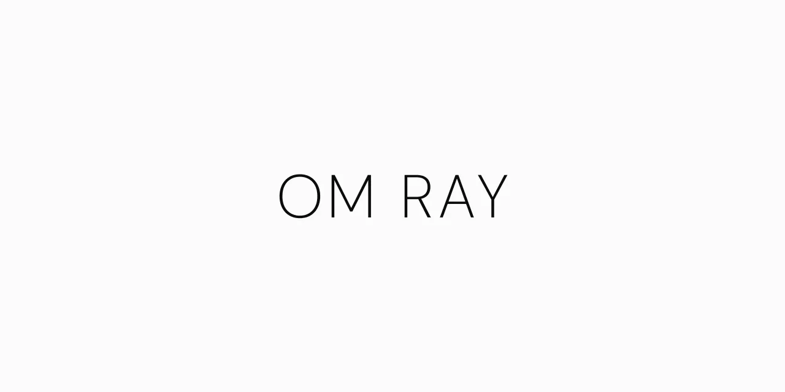

<a href="https://omray.dev">
  <picture>
    <source media="(prefers-color-scheme: dark)" srcset="./assets/hero-dark.webp" />
    <source media="(prefers-color-scheme: light)" srcset="./assets/hero.webp" />
    
  </picture>
</a>

  <a href="https://omray.dev"><picture><source media="(prefers-color-scheme: dark)" srcset="./assets/link-site-dark.svg" /></picture></a>
  <a href="https://x.com/OmRayDev"><picture><source media="(prefers-color-scheme: dark)" srcset="./assets/link-x-dark.svg" /></picture></a>
  <a href="https://www.linkedin.com/in/om-ray-0633971a3/"><picture><source media="(prefers-color-scheme: dark)" srcset="./assets/link-linkedin-dark.svg" /></picture></a>

